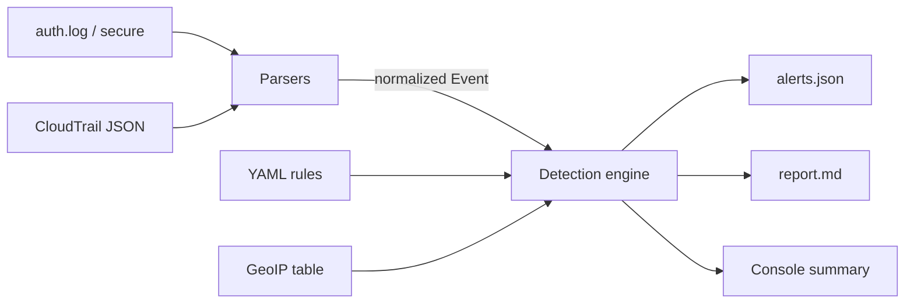

# SOC Detection Engine


A lightweight SIEM-style detection engine that reads **Linux authentication logs** and **AWS CloudTrail**, runs **18 detection rules written in YAML**, and maps every alert to **MITRE ATT&CK**. It produces a JSON alert feed for automation and a Markdown incident report with triage steps for analysts.

I built it to practice the core of SOC work end to end: parsing raw logs, normalizing them into one schema, writing and tuning detections, and documenting a response.

## What it detects

| ID | Detection | Log source | Type | MITRE ATT&CK |
|---|---|---|---|---|
| SSH-001 | SSH brute force from one IP | auth.log | threshold | T1110.001 |
| SSH-002 | SSH password spraying across accounts | auth.log | threshold (distinct users) | T1110.003 |
| SSH-003 | Successful login after repeated failures | auth.log | sequence | T1110 |
| SSH-004 | Direct root login over SSH | auth.log | match | T1078.003 |
| LNX-001 | New local account created | auth.log | match | T1136.001 |
| LNX-002 | User added to sudo/wheel/admin | auth.log | match | T1098 |
| LNX-003 | Interactive root shell via sudo | auth.log | match | T1548.003 |
| AWS-001 | Root account used | CloudTrail | match | T1078.004 |
| AWS-002 | Console login without MFA | CloudTrail | match | T1078.004 |
| AWS-003 | Repeated failed console logins | CloudTrail | threshold | T1110 |
| AWS-004 | Impossible travel between logins | CloudTrail | impossible travel | T1078.004 |
| AWS-005 | AdministratorAccess attached to an identity | CloudTrail | match | T1098.003 |
| AWS-006 | Burst of AccessDenied calls (permission probing) | CloudTrail | threshold | T1580 |
| AWS-101 | CloudTrail stopped or deleted | CloudTrail | match | T1562.008 |
| AWS-102 | GuardDuty disabled | CloudTrail | match | T1562.001 |
| AWS-103 | Security group opened to 0.0.0.0/0 | CloudTrail | match | T1562.007 |
| AWS-104 | S3 Block Public Access removed | CloudTrail | match | T1530 |
| AWS-105 | S3 ACL grants public access | CloudTrail | match | T1530 |

## How it works



1. **Parsers** (`detection_engine/parsers.py`) turn each log format into a common `Event` schema: timestamp, source, event type, outcome, user, source IP, host, action and details.
2. **Rules** (`rules/*.yml`) describe what to look for. The loader validates every rule and rejects unknown types, severities or missing parameters.
3. **The engine** (`detection_engine/engine.py`) supports four rule types:
   - `match`: any event that matches the filter, grouped per entity
   - `threshold`: N events, or N distinct values of a field, inside a sliding time window
   - `sequence`: N events of one kind followed by another, such as failures then a success
   - `impossible_travel`: two logins whose distance and time imply a speed above a limit
4. **Reporters** write a JSON feed and a Markdown report with MITRE links, evidence and recommended response steps.

## Quick start

```bash
git clone https://github.com/<your-github-username>/soc-detection-engine.git
cd soc-detection-engine
python -m venv .venv && source .venv/bin/activate   # Windows: .venv\Scripts\activate
pip install -r requirements.txt

python -m detection_engine scan samples/auth.log samples/cloudtrail.jsonl
```

Output:

```
Analyzed 55 events -> 18 alerts

[CRIT] SSH-003    Successful SSH login after repeated failures  T1110      src_ip=203.0.113.45
[CRIT] AWS-101    CloudTrail logging stopped or deleted         T1562.008  user=bob
[CRIT] AWS-001    AWS root account used                         T1078.004  user=root, src_ip=192.0.2.40
[HIGH] SSH-002    SSH password spraying across many accounts    T1110.003  src_ip=203.0.113.45
[HIGH] AWS-004    Impossible travel between console logins      T1078.004  user=bob
...
By severity: critical=3, high=8, medium=7
```

See the full generated report in [`docs/sample-output/report.md`](docs/sample-output/report.md).

### More commands

```bash
# List loaded rules
python -m detection_engine rules

# Scan your own logs and fail a pipeline if anything high or critical is found
python -m detection_engine scan /var/log/auth.log --out reports --fail-on high

# Use your own GeoIP data (CSV: network,country,city,lat,lon)
python -m detection_engine scan cloudtrail.json --geo geoip.csv
```

## The sample attack scenario

`samples/` contains a fictional attack on 14 October 2026, generated by `tools/generate_samples.py`:

- **Linux host `web01`:** an external IP sprays usernames over SSH, brute-forces `ubuntu`, logs in, opens a root shell with `sudo /bin/bash`, then creates a backdoor account `sysupdate` and adds it to `sudo`.
- **AWS account:** user `bob` signs in from Paris without MFA. Twenty-five minutes later his password is used from São Paulo after failed attempts. The attacker probes permissions (12 AccessDenied errors), attaches AdministratorAccess, stops CloudTrail, deletes GuardDuty, opens SSH to the internet and makes an S3 bucket public.

Benign activity is included on purpose, for example a user who mistypes a password twice and then logs in, to show the rules do not fire on normal behavior. All IPs are from documentation ranges (RFC 5737).

## Writing a rule

```yaml
id: SSH-002
title: SSH password spraying across many accounts
severity: high
type: threshold
mitre:
  tactic: Credential Access
  technique: T1110.003
  name: "Brute Force: Password Spraying"
filter:
  source: linux_auth
  event_type: ssh_login
  outcome: failure
group_by: [src_ip]
threshold: 4
distinct: user          # count unique usernames, not events
window_minutes: 10
response:
  - List every targeted username and check whether any are valid accounts.
```

Filter values can be a literal (`outcome: failure`), a list (`action: [StopLogging, DeleteTrail]`) or an operator (`contains`, `regex`, `in`, `not`, `not_in`, `exists`, `gte`, `lte`). Nested fields use dots, such as `details.mfa_used`.

## Testing

```bash
pip install -r requirements-dev.txt
pytest -v
```

The suite (23 tests) covers the parsers, every rule type, rule validation and an end-to-end check that each shipped rule fires exactly once on the sample attack while benign activity stays quiet. GitHub Actions runs linting, rule validation, tests and a sample scan on every push.

## Project structure

```
detection_engine/   parsers, rule loader, engine, GeoIP, reporters, CLI
rules/              YAML detections grouped by source
samples/            generated attack scenario (auth.log, cloudtrail.jsonl)
tools/              sample generator
tests/              unit and end-to-end tests
docs/sample-output/ example alerts.json and report.md
```

## Roadmap

- Parsers for Windows Security events (4625, 4624, 4720) and VPC Flow Logs
- Export alerts to Splunk HEC or Elastic
- Convert rules to and from the Sigma format

## License

MIT
